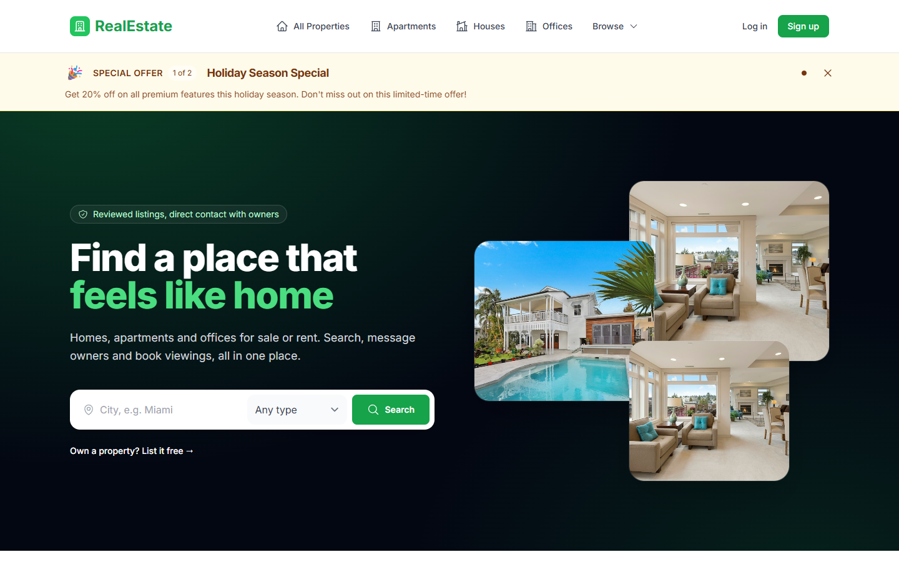
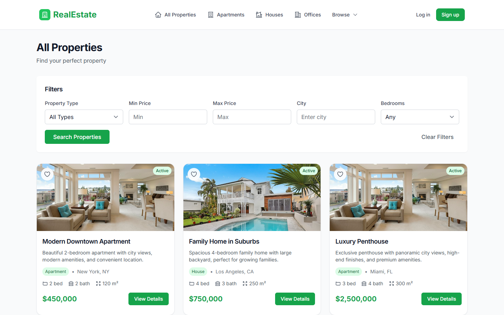
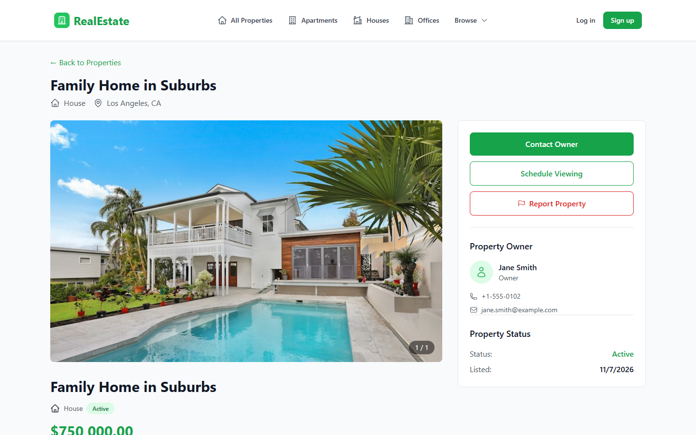
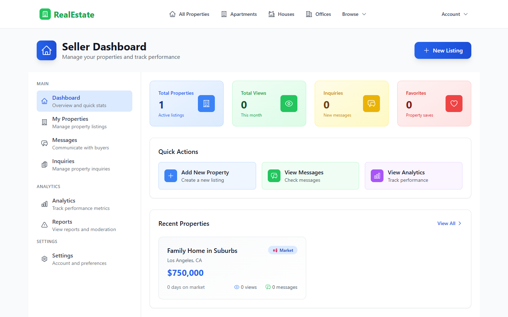
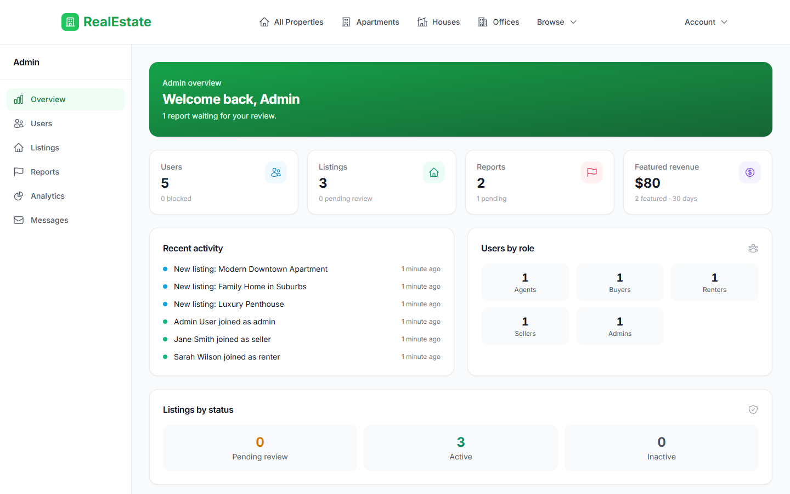
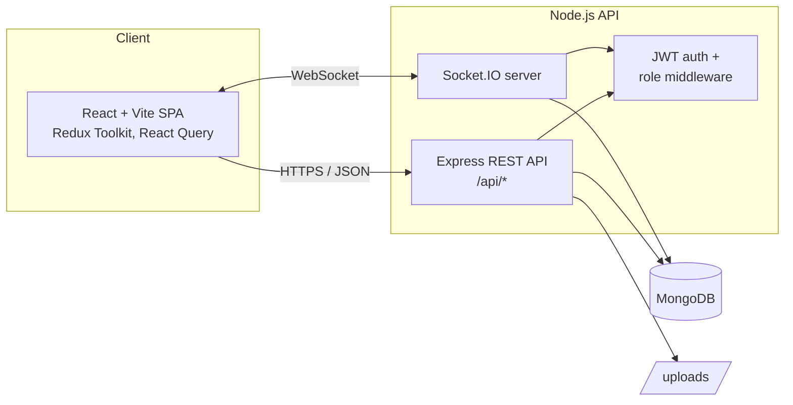

# RealEstate Marketplace

[](https://github.com/iligashi/realestate/actions/workflows/ci.yml)


[](LICENSE)

A full-stack real estate marketplace where buyers, sellers, renters and agents list, discover and discuss properties in real time. Each role gets its own dashboard, and admins have tools to moderate users, listings and reports.



## Features

- **Five user roles:** buyer, seller, renter, agent and admin, with role-specific dashboards and role-based route protection
- **Property listings:** sale and rental listings with photos, filters (type, price, city, bedrooms) and a multi-step listing wizard
- **Real-time messaging:** Socket.IO conversations with typing indicators, read receipts, online status and live notifications
- **Rentals:** rental applications that renters submit and owners review
- **Viewings and open houses:** buyers schedule viewings and sellers manage open houses
- **Buyer tools:** wishlist (saved properties), property comparison and a mortgage calculator
- **Seller analytics:** views, saves and inquiries per listing
- **Moderation:** users report listings, people or messages, and admins review the reports, manage users and approve listings

## Screenshots

| Property search | Property details |
|---|---|
|  |  |

| Seller dashboard | Admin dashboard |
|---|---|
|  |  |

## Security

- Sessions use an **httpOnly, Secure cookie**; the token is never readable by page JavaScript
- CSRF protection on cookie-authenticated writes (`X-Requested-With` header)
- MongoDB operator stripping on all input, escaped search patterns, page-size limits
- Rate limits on login, registration and the contact form
- Only JPEG, PNG, WebP and GIF uploads are accepted
- Unlisted (pending or inactive) properties are visible only to their owner and admins

## Tech stack

| Layer | Technologies |
|---|---|
| Frontend | React 18, Vite, Redux Toolkit, React Router, React Query, Tailwind CSS, Socket.IO client |
| Backend | Node.js, Express, Mongoose, Socket.IO, JWT, express-validator, Multer, Helmet, rate limiting |
| Database | MongoDB 7 (2dsphere geospatial index for locations) |
| Testing | Jest, Supertest, mongodb-memory-server |
| Tooling | ESLint, Prettier, GitHub Actions, Docker, docker compose |

## Architecture



## Getting started

### Prerequisites

- Node.js 20 or newer
- MongoDB 7, either installed locally or started with Docker (`docker compose up -d mongo`)

### 1. Install

```bash
git clone https://github.com/iligashi/realestate.git
cd realestate
npm run install:all
```

### 2. Configure

```bash
cp backend/.env.example backend/.env
cp frontend/.env.example frontend/.env
```

Set `JWT_SECRET` in `backend/.env` to a long random value:

```bash
node -e "console.log(require('crypto').randomBytes(48).toString('hex'))"
```

| Variable | Where | Description |
|---|---|---|
| `MONGODB_URI` | backend | MongoDB connection string |
| `JWT_SECRET` | backend | Secret used to sign login tokens (required) |
| `JWT_EXPIRE` | backend | Token lifetime, e.g. `7d` |
| `FRONTEND_URL` | backend | Allowed CORS origins, comma-separated |
| `PORT` | backend | API port (default `5000`) |
| `LOG_LEVEL` | backend | `debug`, `info`, `warn`, `error` or `silent` |
| `CLOUDINARY_URL` | backend | Store uploads on Cloudinary instead of local disk (recommended in production) |
| `SENTRY_DSN` | backend | Report API errors to Sentry (optional) |
| `COOKIE_SAMESITE` | backend | Session cookie SameSite policy (default `lax` locally, `none` in production) |
| `VITE_SENTRY_DSN` | frontend | Report browser errors to Sentry (optional) |
| `VITE_SERVER_URL` | frontend | URL of the API server (default `http://localhost:5000`) |

### 3. Seed demo data (optional)

```bash
npm run seed
```

This creates demo users for every role, sample listings and announcements. The script prints the demo login details when it finishes.

### 4. Run

```bash
npm run dev
```

- Frontend: http://localhost:3000
- API: http://localhost:5000 (health check at `/health`)

### Run everything with Docker

```bash
echo "JWT_SECRET=$(node -e "console.log(require('crypto').randomBytes(48).toString('hex'))")" > .env
docker compose up --build
```

## Scripts

Run these from the repository root:

| Command | Description |
|---|---|
| `npm run install:all` | Install root, backend and frontend dependencies |
| `npm run dev` | Start the API and the frontend together |
| `npm run seed` | Load demo data into MongoDB |
| `npm test` | Run the backend test suite |
| `npm run lint` | Lint backend and frontend |
| `npm run build` | Build the frontend for production |

## Testing

```bash
npm test
```

The API tests run against an in-memory MongoDB, so they need no database setup. They cover authentication (including blocking self-registration as admin), authorization on property changes, NoSQL-injection and regex-injection protection, page-size limits, viewing bookings, the reports API and error handling. CI runs lint, tests and a production build on every push and pull request.

## Project structure

```
.
├── backend/
│   ├── app.js              Express app (middleware + routes), imported by tests
│   ├── server.js           HTTP server, database connection, Socket.IO
│   ├── config/             Environment and database configuration
│   ├── controllers/        Request handlers
│   ├── middleware/         Auth, validation, uploads, error handling
│   ├── models/             Mongoose schemas
│   ├── routes/             REST API routes
│   ├── websocket/          Socket.IO server
│   ├── scripts/            Seed scripts
│   └── tests/              Jest + Supertest API tests
├── frontend/
│   ├── src/components/     UI components grouped by role and feature
│   ├── src/pages/          Route-level pages (lazy-loaded)
│   ├── src/services/       API clients
│   └── src/store/          Redux Toolkit slices
├── docs/                   API, WebSocket and upload docs, screenshots
└── docker-compose.yml
```

## Documentation

- [Deployment (Vercel + Render + MongoDB Atlas)](docs/deployment.md)
- [REST API reference](docs/api.md)
- [Real-time messaging (WebSockets)](docs/websockets.md)
- [Property image uploads](docs/image-uploads.md)

## License

[MIT](LICENSE) © Ilaz Gashi
